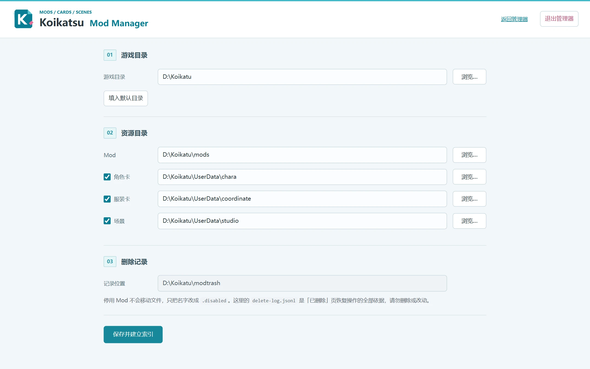
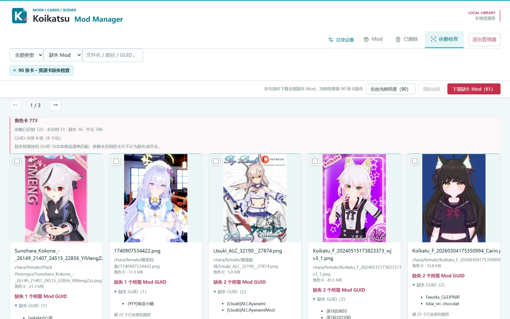
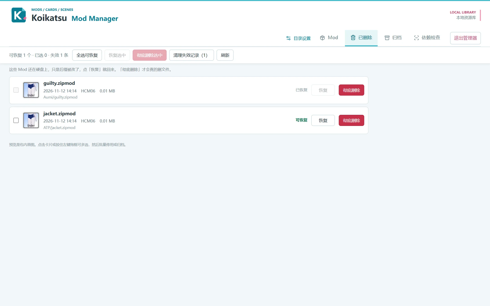

# Koikatsu Mod Manager

在浏览器中管理 Koikatsu / Koikatsu Sunshine 的 Mod、角色卡、服装卡与场景。Windows 10/11 64 位，免安装。

## 安装

1. 从 **Releases** 下载 ZIP，解压到可写入的文件夹（不要直接在压缩包里双击运行）。
2. 双击 `KoikatsuModManager.exe`，默认浏览器会自动打开。**`_internal` 文件夹必须和 EXE 放在一起。**
3. 首次启动选择游戏目录与各类资源目录，保存后自动建立索引（资源多时首次扫描较慢，页面会显示进度，之后复用缓存）。

不需要安装 Python、依赖包或 WebView2。关闭标签页后管理器仍在后台运行，再次双击 EXE 即可重新打开；用页面上的「退出管理器」结束程序。

## 功能

- **Mod 列表**：显示包内预览图，可按名称、作者、分类或 GUID 搜索；每张卡标出被多少张角色卡、服装卡、场景卡引用，点那行数字就能看到具体是哪些卡（带缩略图），也能按「卡片引用」筛选出没人用的包。
- **批量操作**：点击勾选，或在封面上拖拽框选（指针靠近窗口上下边缘会自动滚动），勾选后可批量停用、归档、补充缩略图。
- **GUID 冲突提示**：两个包共用同一 GUID 时，卡片上会直接标出来，也能用「只看冲突」一次筛全——游戏只会加载其中一份，留哪份由包内版本号决定。
- **自定义分类**：在「编辑作品 / 角色 / 作者」里补充标注，下次启动保留，下拉候选来自已保存的分类。
- **依赖检查**：列出缺 Mod 的卡片与所缺 GUID，可逐张勾选后一次补齐。它有独立的筛选与翻页，进出不会打乱 Mod 列表的位置。
- **已删除**：按删除日志列出所有停用记录，标明能否恢复、为什么不能，可单选或全选后批量恢复。
- **归档**：把整个压缩包移到 Mod 目录之外的备份文件夹，保留原相对路径，随时可以移回来。
- 翻页会保留当前页码与滚动位置；预览图可在窗口内放大，并切换上一张、下一张。

## 下载缺失的 Mod

在「依赖检查」勾选卡片（一张都不勾表示全部缺失项），点「下载缺失 Mod」。程序逐个确认每个 GUID 在公共整合站里有没有对应包，只下载真正缺的那几个，不会整包下载。

- 数据来自公开整合站 `sideload.betterrepack.com`，本项目不托管、也不分发任何 Mod。
- 第一次点要先读一遍公共索引（七千多个归档），耗时取决于网络，页面会持续显示进度。**读完当场就能下载**；目录清单缓存七天，期间再点直接进匹配。中途取消不会留下坏文件，只是下次需要从头读。
- **KK 与 KKS 共用一份索引**，不会因为识别成另一个版本而什么都下不到。
- 同一个 GUID 有多个版本时，优先当前游戏的那份。**只有另一个版本时也照样下载**——包能不能用最终由游戏判断（Sideloader 会跳过不匹配的包），管理器不替用户裁决，所以下载结果只报「匹配几个、下载几个」。
- 下载后按包的内容放进 `mods` 下对应子目录（`ForCharactersLoading`、`ForStudioScenesLoading`、`KK_-ExtraMaps`），与手动安装的位置一致。
- 包多大都会下（地图包常见 1–2 GB），唯一的门槛是磁盘剩余空间；不够时会直接说需要多少、还剩多少。

**网络说明**：程序走自己的网络通道，和浏览器是两条路——浏览器能打开整合站，不代表程序也能。用了加速器或浏览器插件代理的话，请同时把系统代理打开。失败原因写在 `runtime\manager.log`，会指出卡在哪一步。

## 停用、归档与恢复

**停用**适合「游戏别加载它」，**归档**适合「保留这份文件，但不装在游戏里」。两个动作互不影响，也不共用记录。

点 Mod 卡片右上角的垃圾桶图标即停用：文件名末尾追加 `.modmanager-<时间>.disabled`，**文件留在原目录**，游戏不再加载；恢复只是把名字改回去。

点它左边的档案盒图标即归档：整个压缩包被**移动到 Mod 目录之外的归档文件夹**（默认 `<游戏目录>\mods_archive`，可在目录设置里改），并保留原来的相对路径，比如 `mods\Aumi\guilty.zipmod` 会变成 `mods_archive\Aumi\guilty.zipmod`。包内文件不做任何改动，游戏也不会再扫描到它。

- 刚删完时，工具栏的「撤销删除」可以逐层退回本次删掉的批次。
- 「已删除」视图读 `modtrash\delete-log.jsonl`，不依赖标签页，重启后仍可恢复。文件被手动移走、同名文件已重新安装、删除用的是另一个 Mod 目录，都会标注为不可恢复。
- 行末红色的「彻底删除」会真正移除 `.disabled` 文件，是唯一不可撤销的操作，点击前会确认要删几个文件、共多大。
- 「清理失效记录」只重写删除日志，把注定恢复不了的记录从列表里去掉，不碰任何文件。
- 「归档」视图读归档文件夹里的 `archive-log.jsonl`，列出每个归档包的时间和原路径，勾选后「取回」就移回原位。原位置已经有同名文件、归档文件被手动移走、或换了归档目录时，都会标注为不可取回。**这一页没有任何删除操作**——归档当备份用，清除归档请直接在资源管理器里处理。

`modtrash` 里只有这份日志，没有任何 Mod 文件，所以目录设置中它是只读的。归档文件夹则相反：文件就放在里面，换机器或做备份时整个文件夹拷走即可，`archive-log.jsonl` 会跟着走。

## 注意事项

- 「没被任何卡片引用」不等于无用：Mod 可能只用于场景、服装卡或无法解析的卡片，删之前自己确认一下。
- 预览图来自包内原图、`ThumbTex` 缩略图，或引用该包的资源卡封面（角上标注）；三者都没有时游戏里同样显示空白，程序不会凭空渲染模型。
- 外部增删资源后需重启管理器以更新索引。
- 配置、索引和日志都在 EXE 同目录，该目录需要可写。

## 无法启动

确认已完整解压并放在可写入的文件夹，正常双击即可，无需管理员权限。日志在 `runtime/manager.log`。如果没自动打开网页，可双击 `runtime/Open-Manager.url`；仍然打不开时，把整个程序文件夹复制到桌面再启动。

## 从源码运行

需要 Python 3.11 或更新版本（推荐 3.12 / 3.13 的 64 位版本）。先运行 `Install-ModManager.bat` 安装依赖，再运行 `Open-ModManager.bat`。

前端按视图拆分：`app-core.js` 负责视图注册、路由、分页与写操作，各视图（`view-mods.js`、`view-trash.js`、`plugin-deps.js`）只做渲染，共享服务在 `media-thumbs.js`、`mod-search.js`、`preview-ui.js`、`settings-ui.js`。缺失 Mod 的判定只在 `Build-LibraryIndex.dependencies()` 里算一次，前端读 `deps.js` / `/api/deps`。第三方素材与依赖见 `THIRD_PARTY_NOTICES.md`，本项目采用 MIT 协议。

## 声明

本项目是非官方工具，与 Illusion 及 Koikatsu 的权利方无关。仓库只包含管理器本身的源码，**不包含游戏本体、Mod、角色卡或任何游戏资源**。下载功能只是向公开的第三方整合站发起请求，本项目不托管也不分发那些文件；请自行确认使用方式符合当地法律与游戏许可。
